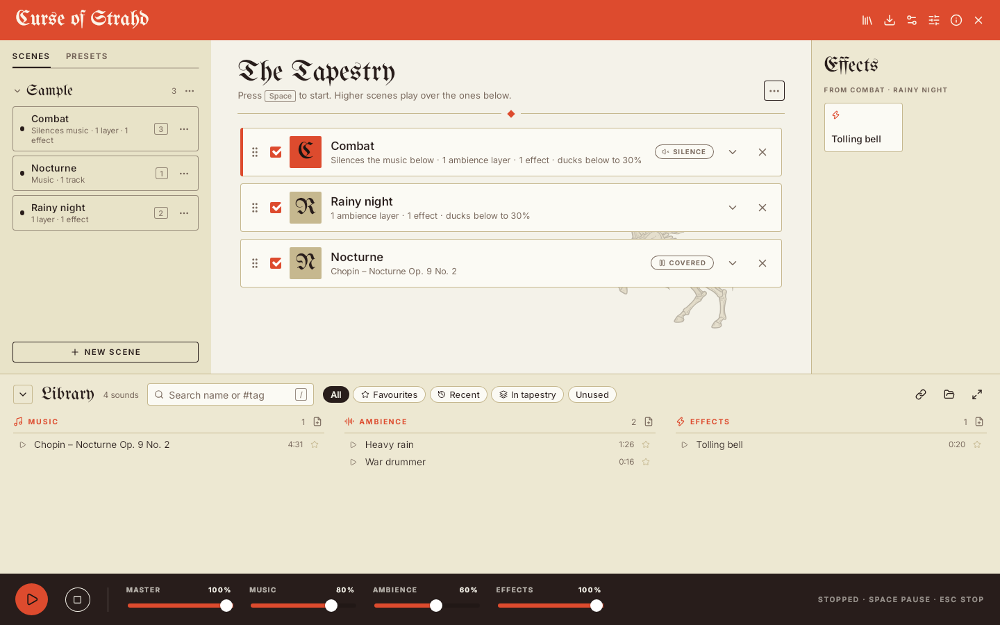

# Comilito

A lightweight desktop soundboard and mixer for game masters of tabletop role-playing games, such
as Dungeons & Dragons, Pathfinder or Call of Cthulhu.

Comilito is free and made in spare time. If it livens up your table, you can support its
development with a donation on Liberapay or Ko-fi:

[](https://liberapay.com/colorcrow/donate)
[](https://ko-fi.com/N8Q82AYC2B)

> **Disclaimer:** Comilito was made mostly with AI (Claude, through Claude Code). The author
> directs the design and the decisions and tests the app, but most of the code was written by AI.



## What it does

Comilito lets a game master build a library of sounds for a session and play them live,
organised into three categories:

- **Music** — background tracks (usually one at a time, with crossfades)
- **Ambience** — looping environmental layers (rain, tavern chatter, wind…) that can be stacked
- **Effects** — short one-shot sounds (door slam, dragon roar, spell cast)

Each scene sets its own Music, Ambience and Effects volumes (the top scene of the Tapestry
decides them), and each sound has its own volume, loop and fade settings.

## Using Comilito

1. **Create a project** (one per campaign). It's a folder in `~/Documents/Comilito/`.
   Choose **Start from the sample** to get a few sounds and scenes to try things out.
2. In **Sounds**, add music, ambience and effect files; they're
   copied into the project. You can also drop files straight into the project's
   `audio/music`, `audio/ambience` or `audio/effects` folder; they appear within seconds.
   ▶ previews a sound; ✎ sets its volume, loop and fades. Drag a sound onto another
   category's tab to move it there.
3. In **Scenes**, create scenes: a music playlist, ambience layers (each with a volume and a
   role: foreground, background or supporting), effects for the pad, and optionally a hotkey.
4. Drag scenes into the **stack** (or double-click them). Scenes higher up
   duck the ambience below them; the top-most scene with music plays its music.
   Tick a scene off to disable it without removing it; drag it out of the stack to remove it.
5. **Space** starts / pauses, **Esc** stops everything, scene hotkeys add or toggle a scene.
   Click a stack entry to see its layers' effective volumes and adjust them live, or drag a
   sound from the Sounds tab onto it to add it to that scene.
6. **Save stack as preset** for stacks you reuse; drag a preset in, or right-click → Replace stack.

Everything saves automatically. See [docs/scenes.md](docs/scenes.md) for how the stack works.

## Sharing and saving

Each project is a plain folder in `~/Documents/Comilito/` with its settings (`comilito.json`)
and its own audio files. Put those folders in a synced location to use them on several devices.

A project can also be exported as a single `.comilito` file (a zip) and imported elsewhere:

- **With audio included** — one self-contained file, everything works on import.
- **Without audio** — a small file holding only the configuration. On import, Comilito
  asks you to point it at a folder (or individual files) for any audio it can't find.

See [docs/save-format.md](docs/save-format.md).

## Platforms

- Linux (primary): a Flatpak (on Flathub, coming) and an AppImage
- Windows
- macOS and Android (planned, not yet supported)

## Tech stack

- [Tauri 2](https://tauri.app) — app shell, uses the OS webview (no bundled browser)
- **Rust** — audio engine ([kira](https://github.com/tesselode/kira)) and file handling
- **Svelte + TypeScript** — user interface

See [docs/architecture.md](docs/architecture.md) and [docs/decisions/](docs/decisions/).

## Status

First version: projects, a sound library, scenes, the scene stack with ducking and roles,
presets, an effects pad, export/import, relinking missing audio, hashing and automatic backups,
downloads that resume after a restart, a warning when quitting while work is running, and
videos for scenes in a window of their own (docs/video.md).

## Uninstalling

Removing Comilito itself depends on how you installed it:

- **Flatpak:** remove it from your software centre, or `flatpak uninstall me.colorcrow.comilito`
  (add `--delete-data` to remove its data too).
- **AppImage:** delete the `.AppImage` file. If AppImageLauncher (or a similar tool) added it to
  your app menu, remove it from there too, or delete its entry in `~/.local/share/applications/`.
- **Windows installer:** Settings › Apps › Comilito › Uninstall.

That leaves your **projects** and Comilito's own **data** on the computer, on purpose: projects
are your work, and uninstalling shouldn't take them with it.

**Comilito's data** (settings, your own themes, logs, backups, the downloaded yt-dlp and ffmpeg,
about 400 MB): the easy way is *Preferences › Projects & tools › Remove all data and quit*, before
uninstalling. It deletes the folders below (asking whether to keep the backups) and leaves your
projects alone. To do it by hand:

| | Linux | Windows |
|---|---|---|
| Preferences and your own themes | `~/.config/comilito/` | `%APPDATA%\comilito\` |
| Window size and position | `~/.config/me.colorcrow.comilito/` | `%APPDATA%\me.colorcrow.comilito\` |
| Backups, logs, downloaded tools, webview storage | `~/.local/share/me.colorcrow.comilito/` (backups in `backups/`) | `%APPDATA%\me.colorcrow.comilito\` and `%LOCALAPPDATA%\me.colorcrow.comilito\` |
| Cache (may not exist) | `~/.cache/me.colorcrow.comilito/` | `%LOCALAPPDATA%\me.colorcrow.comilito\` |

On Linux, `~/.config`, `~/.local/share` and `~/.cache` are the defaults; if you've set
`XDG_CONFIG_HOME`, `XDG_DATA_HOME` or `XDG_CACHE_HOME`, look there instead. The Flatpak keeps
all of these in `~/.var/app/me.colorcrow.comilito/` (`config/`, `data/`, `cache/`), and
`flatpak uninstall --delete-data me.colorcrow.comilito` removes them.

**Your projects**, only if you want them gone too: the projects folder, `~/Documents/Comilito/` by
default (Preferences › Projects & tools shows where yours is). It holds one folder per project. Delete single projects from the home screen (⋯ › Delete), or the whole
folder by hand.

## Development

Prerequisites:

- Rust (via [rustup](https://rustup.rs))
- Node.js 20+
- Linux system libraries (Debian/Ubuntu/Pop!_OS; other distros: see
  [Tauri prerequisites](https://v2.tauri.app/start/prerequisites/)):

  ```sh
  sudo apt install libwebkit2gtk-4.1-dev build-essential curl wget file \
    libxdo-dev libssl-dev libayatana-appindicator3-dev librsvg2-dev libasound2-dev patchelf
  ```

  `libasound2-dev` (ALSA) is for audio output. `patchelf` is for building the AppImage, which
  carries the GStreamer plugins WebKit plays videos with.
- Docker (optional), for building AppImages that run on older distros; see [Packaging](#packaging).

Run:

```sh
npm install        # once, and after dependencies change
npm run tauri dev  # starts the app with hot reload for the UI
```

Other commands:

| Command | What it does |
|---------|--------------|
| `npm run check` | Type-check the Svelte/TypeScript code |
| `npm run package` | Build the release packages. On Linux, an AppImage in `src-tauri/target/release/bundle/appimage/`, built in an Ubuntu 22.04 container when Docker is running (see below) |
| `cargo test --manifest-path src-tauri/Cargo.toml` | Run the Rust tests |

### Packaging

Use `npm run package` rather than `npm run tauri build` for anything you'll give to others.

On Linux it makes an **AppImage** (there's no `.deb` or `.rpm`; the Flatpak is built separately, see
[docs/flatpak.md](docs/flatpak.md)). An app built
on Linux only runs where glibc is at least as new as on the computer that built it, and glibc
can't be bundled. So when [Docker](https://docs.docker.com/engine/install/) is running, the build
happens in an Ubuntu 22.04 container and the AppImage runs on Ubuntu 22.04 and newer, whatever
your own computer runs. The first run takes a while (it sets up the container and compiles
everything); later runs are much quicker. Without Docker it builds on your computer and warns
which glibc the AppImage needs. `npm run package -- --docker` or `-- --local` picks one.

The AppImage carries only the GStreamer plugins videos need; see
[decision 0041](docs/decisions/0041-gstreamer-in-the-appimage.md). Why the container:
[decision 0046](docs/decisions/0046-packaging-linux-in-a-container.md).

## Contributing

You can support Comilito with a donation on Liberapay or Ko-fi:

[](https://liberapay.com/colorcrow/donate)
[](https://ko-fi.com/N8Q82AYC2B)

Code is welcome too: open a pull request with a fix or a feature (for anything big, open an issue
first so we can agree on the approach). [CLAUDE.md](CLAUDE.md) and [docs/](docs/) describe how
the app is built and the rules it follows.

## Acknowledgements

Inspired by [Ascapes Mixer](https://github.com/ilyaly/ascapes-mixer) by ilyaly (MIT) and
[dnd-soundboard](https://github.com/carolinabras/dnd-soundboard) by carolinabras.
Comilito is an independent implementation, not a fork of either. Sample audio credits and other
acknowledgements are in [CREDITS.md](CREDITS.md) and the app's About window.
